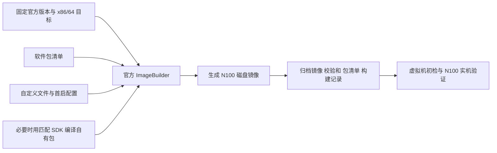

# 基于官方 OpenWrt 的 N100 私有定制固件：GitHub 项目调研

调研日期：2026-10-11。范围：读取官方文档、GitHub README、构建脚本、工作流及发布元数据；没有运行第三方脚本、编译、刷机或测试 N100 实机。本文中的项目机制为源码观察，面向本项目的取舍为建议。

后续进展（2026-10-12）：本项目已建立官方 ImageBuilder 配方，目标为 `eth0` WAN、`eth1–eth3` LAN，并预装固定版本 Nikki。实现入口及当前验证范围见 [项目 README](../../README.md)；以下内容保留原调研时的证据口径。

## 结论

本项目适合从 **官方稳定版 ImageBuilder + 软件包清单 + 自定义文件 + 首次启动配置 + 私有构建流水线** 开始。只有确定需要修改内核、驱动或底层补丁时，再切换到官方 OpenWrt 源码全量编译。

GitHub 上“OpenWrt 定制”主要包含三类工作，不能只看仓库名称：

| 路线 | 实际做的事 | 能改到哪里 | 本项目适用性 |
|---|---|---|---|
| 官方 ImageBuilder | 使用官方已编译内核和软件包，按选择重新组装镜像 | 包、配置、文件、受支持的镜像布局参数 | 第一选择 |
| 官方源码 Buildroot | 从 `openwrt/openwrt` 的固定版本构建工具链、内核和包 | 包含内核配置、驱动和源码补丁 | 有底层修改需求再用 |
| 第三方分支或固件二次打包 | 使用 Lean/LEDE、ImmortalWrt 或其他预编译 rootfs/内核 | 由第三方分支和打包方式决定 | 可参考自动化，不直接作为官方基线 |

ImageBuilder 不是把下载到的成品 `.img.gz` 解压修改，也不负责从软件包源码编译程序。官方 SDK 可用于编译匹配版本和架构的自有软件包，再交给 ImageBuilder；全量 Buildroot 才负责内核和完整系统源码构建。[官方 ImageBuilder](https://openwrt.org/docs/guide-user/additional-software/imagebuilder)、[官方 SDK](https://openwrt.org/docs/guide-developer/toolchain/using_the_sdk)、[官方源码构建说明](https://github.com/openwrt/openwrt#quickstart)。

## 代表项目及其工作方式

### 1. openwrt/docker：官方构建工具容器化

这个仓库提供 ImageBuilder、SDK 等容器环境。定制项目可把包列表和文件目录传入容器，通过 ImageBuilder 生成镜像，并把产物和下载缓存挂载回宿主机。它是构建工具基础设施，不是一套预先加入大量插件的成品固件。

对本项目的价值是保留官方构建基础，让本地和 CI 使用一致的环境。应固定 OpenWrt 版本、目标平台和容器 digest；不同版本/平台的包缓存要隔离。Docker 解决构建环境封装，但仍要核对镜像的宿主执行架构；Mac 的 CPU 架构不等于 N100 的目标架构。[源码与使用示例](https://github.com/openwrt/docker)。

### 2. itiligent/Easy-OpenWRT-Builder：直接面向 x86 的轻量配方

其 `x86-imagebuilder.sh` 直接从 `downloads.openwrt.org` 下载官方 ImageBuilder，配置目标为 x86/64、profile 为 generic，然后把软件包选择、自定义文件和分区大小等参数传给构建器；还提供虚拟机磁盘格式转换流程。

值得借鉴的是“一个固件配方 + 官方 ImageBuilder”的简洁边界。本项目用 N100 裸机时，只需要镜像组装部分，虚拟机转换不是必需功能。脚本中的版本和软件包只是作者的配方，使用前仍需针对当前官方版本核对。该脚本目前面向 Debian/Ubuntu 且包含交互输入，需要改成容器化、无交互的参数入口后才适合本项目 CI。[项目](https://github.com/itiligent/Easy-OpenWRT-Builder)、[x86 构建脚本](https://github.com/itiligent/Easy-OpenWRT-Builder/blob/88e1e67caf5835b13212662cc8247837a485178b/x86-imagebuilder.sh)。

### 3. EkkoG/OpenWrt：将软件包和配置组织成模块

本轮读取默认分支提交 `c060aff3fe314b7544e42900c944853ba96905e3`，提交时间为 2025-09-23。

执行链路如下：

1. GUI 或 `run.sh` 接收 ImageBuilder 镜像、profile、输出目录和模块目录。
2. `run.sh` 生成 Docker Compose 配置，将脚本、模块和环境变量挂入容器。
3. `build.sh` 遍历内置及自定义模块，收集 `packages`，合并 `files/`，对 `files/etc/uci-defaults/` 中的变量进行替换。
4. 检查模块目标文件冲突，运行模块的可选后处理脚本。
5. 执行 `make image PACKAGES=... FILES=...`，按需传入 `PROFILE`。

这种模块结构值得借鉴，尤其是把“安装哪些包”和“如何初始化这些包”放在同一功能目录，并在文件冲突时失败。[run.sh](https://github.com/EkkoG/OpenWrt/blob/c060aff3fe314b7544e42900c944853ba96905e3/run.sh)、[build.sh](https://github.com/EkkoG/OpenWrt/blob/c060aff3fe314b7544e42900c944853ba96905e3/build.sh)。

但不能将此项目原样视为纯官方模板：

- `setup/build-setup.sh` 会默认添加作者的两个第三方 opkg 软件源及密钥，而不只是使用所选 ImageBuilder 的官方源。
- 默认模块包含将现有 WAN 以外的 `eth*` 网口加入 LAN 桥的逻辑。N100 的物理端口用途尚未确定，不应直接继承该网络策略。
- 当前 CI 矩阵使用 ImmortalWrt 24.10.2 和 23.05.4，不能作为当前官方 OpenWrt 25.12.5 兼容性的证据；源码里仍有明显的 opkg 配置路径。

证据：[软件源设置](https://github.com/EkkoG/OpenWrt/blob/c060aff3fe314b7544e42900c944853ba96905e3/setup/build-setup.sh)、[网络初始化](https://github.com/EkkoG/OpenWrt/blob/c060aff3fe314b7544e42900c944853ba96905e3/modules/add-all-device-to-lan/files/etc/uci-defaults/99-add-all-device-to-lan)、[CI 矩阵](https://github.com/EkkoG/OpenWrt/blob/c060aff3fe314b7544e42900c944853ba96905e3/.github/workflows/main.yml)。

### 4. P3TERX/Actions-OpenWrt：经典的全源码 CI 模板

它把传统 OpenWrt 编译步骤搬进 GitHub Actions：准备 Linux runner，拉取上游源码，更新 feeds，运行两段 DIY 脚本，装入 `.config` 和 `files/`，补齐配置、下载依赖、编译，最后上传固件或创建 Release。

值得借鉴的是构建阶段划分、配置与脚本分离、产物归档。但本轮发现该仓库已归档，而且工作流默认来源是 `coolsnowwolf/lede` 的 `master`，不是官方 `openwrt/openwrt`。其 `diy-part1.sh` 还启用了额外的 `fw876/helloworld` feed。它适合作为流程参考，不能原样满足本项目的官方基线要求。[实际工作流](https://github.com/P3TERX/Actions-OpenWrt/blob/decaa5c260535c302a0d59d53b598bb409fd54dd/.github/workflows/openwrt-builder.yml)、[feeds 脚本](https://github.com/P3TERX/Actions-OpenWrt/blob/decaa5c260535c302a0d59d53b598bb409fd54dd/diy-part1.sh)、[仓库归档状态](https://api.github.com/repos/P3TERX/Actions-OpenWrt)。

### 5. haiibo/OpenWrt、ophub/amlogic-s9xxx-openwrt：成品方案和二次打包的对照

`haiibo/OpenWrt` 是更接近“作者自用成品配方”的全源码编译项目，包含 x86_64 配置、第三方插件和默认设置；本轮检查已归档，工作流默认也使用 Lean/LEDE。它说明了如何将多个插件组合成固件，但不适合直接继承为官方最小基线。[x86 工作流](https://github.com/haiibo/OpenWrt/blob/c51c06381c1deff2ab8dad37a05e4a5bae6afb31/.github/workflows/X86_64-OpenWrt.yml)、[仓库归档状态](https://api.github.com/repos/haiibo/OpenWrt)。

`ophub/amlogic-s9xxx-openwrt` 支持多种上游来源，并包含从 rootfs 配合内核和引导文件重新打包的流程，主要处理 ARM 电视盒子等设备。其多设备发布自动化值得研究，但硬件适配和 `ophub/kernel` 内核打包逻辑不应搬到 N100 的官方 x86 固件中。[ImageBuilder 工作流](https://github.com/ophub/amlogic-s9xxx-openwrt/blob/30f81d60774bfc00865e16bfb33d6c80a1261033/.github/workflows/build-openwrt-using-imagebuilder.yml)。

### 6. 两个补充样本

`trinhpham/openwrt-custom-image-builder` 展示了 Docker + 配方脚本 + CircleCI 的组合。源码样例偏小米设备，不能据此宣称已有 N100 适配；当前工作流未配置每周定时触发，不能采用搜索摘要中的“每周自动构建”描述。[构建脚本](https://github.com/trinhpham/openwrt-custom-image-builder/blob/b5c20a50c986940c6ca210246a9292d2903a32f5/build.sh)、[CI](https://github.com/trinhpham/openwrt-custom-image-builder/blob/b5c20a50c986940c6ca210246a9292d2903a32f5/.circleci/config.yml)。

`izer-xyz/openwrt-imagebuilder-action` 将官方 ImageBuilder 封装为 composite Action，传入参数并挂载自定义文件/包目录。可参考其 Action 包装方法，但 README 和测试仍围绕旧版本/ARM 样例，需重新验证当前包管理器和产物路径。[Action 定义](https://github.com/izer-xyz/openwrt-imagebuilder-action/blob/7862cfcfda55e33261b1d376ade9200b8b0d880f/action.yml)、[构建脚本](https://github.com/izer-xyz/openwrt-imagebuilder-action/blob/7862cfcfda55e33261b1d376ade9200b8b0d880f/make_image.sh)。

## 本项目建议采用的工作流

建议本仓库主要维护定制配方，不必一开始复制整个 OpenWrt 源码树：

- **版本与目标**：固定 OpenWrt 发行版、`x86/64`、`generic`、构建器校验值或容器 digest。
- **包清单**：显式记录增删的包；自有包需要匹配版本和架构，内核模块还必须匹配内核 ABI。
- **文件与初始化**：将静态文件放入 overlay；用 `/etc/uci-defaults/` 编写可重复执行的初始化逻辑。设备特有账号、密码和密钥与可复用配方分开管理，尽量在部署时注入。
- **构建入口**：同一配方先支持人工触发 CI，验证稳定后再考虑定时构建。构建成功与设备升级分开。
- **产物记录**：镜像、SHA256、实际安装包版本、配方提交、上游/feeds 版本和构建日志一起归档；仅锁定 OpenWrt 版本并不能保证外部包源永远不变化。
- **验证**：检查镜像分区与包清单，再核对 N100 启动、所有网口、WAN/LAN、DNS/DHCP、所选功能和升级行为。本次尚未进行这些测试。

这是面向本项目的设计建议，不是已创建的构建配置。当前未确定插件清单、主路由/旁路由模式、WAN 类型、网口分配和存储布局，因此没有预先选择这些行为。

## 版本、N100 与升级边界

截至本轮查询，官方 GitHub 最新稳定 Release 为 **25.12.5**，发布于 2026-07-01 UTC。应在真正开始实现时再次确认版本，而不是长期使用 `latest` 或 `SNAPSHOT`。[官方 Release](https://github.com/openwrt/openwrt/releases/tag/v25.12.5)、[官方下载目录](https://downloads.openwrt.org/releases/25.12.5/targets/x86/64/)。

N100 对应官方 **x86/64 → Generic x86/64**；CPU 型号本身不要求另造一个 N100 target。UEFI 裸机使用 `generic-*-combined-efi.img.gz`，Legacy BIOS 使用不带 `-efi` 的 combined 镜像。若选择 squashfs，25.12.5 的对应文件为 `openwrt-25.12.5-x86-64-generic-squashfs-combined-efi.img.gz`；也有 ext4 变体。最终文件系统、分区大小和启动模式应根据实际安装/恢复需求选择，不因硬盘容量大就直接扩大整个系统分区。[官方 x86 说明](https://openwrt.org/docs/guide-user/installation/openwrt_x86)、[实际镜像及 profile 元数据](https://downloads.openwrt.org/releases/25.12.5/targets/x86/64/profiles.json)。

注意 `x86/64` 的 `generic` profile 与 32 位的 `x86/generic` target 不同。ext4 是可写根文件系统；squashfs 使用只读系统基底与可写 overlay，适合需要恢复出厂默认值的场景。这里没有预先决定本项目使用哪一种。[官方镜像说明](https://openwrt.org/docs/guide-user/installation/openwrt_x86#download_disk_images)。

当前 generic profile 包含 `kmod-igc`。若设备使用 Intel I226-V，应核对该驱动与实际网口识别；物理口顺序不能只凭 `eth0` 等名字推断。此处不把此前讨论的网卡/内存/硬盘型号当作本次已重新确认的整机配置。[官方 x86 网卡说明](https://openwrt.org/docs/guide-user/installation/openwrt_x86#packages_to_consider_on_x86)、[generic 设备包定义](https://github.com/openwrt/openwrt/blob/v25.12.5/target/linux/x86/image/64.mk)。

25.12.5 使用 APK 包体系，实际 profile 的默认包包含 `apk-mbedtls`。旧项目中的 `.ipk`、`opkg` 命令和软件源路径不能机械沿用，也不能认为 SDK 编出的任意包都可跨发行版使用。匹配的本地 APK 可以放入 ImageBuilder 的 `packages/`，具体索引和公钥处理按该版本实现。[实际 profiles.json](https://downloads.openwrt.org/releases/25.12.5/targets/x86/64/profiles.json)、[25.12.5 本地 APK 说明](https://github.com/openwrt/openwrt/blob/v25.12.5/target/imagebuilder/files/README.apk.md)。

官方 Firmware Selector 是 ASU 的一个前端：提交设备、版本、包清单等信息，由服务器调用 ImageBuilder 生成定制镜像；也支持 UCI defaults。它很适合快速验证官方包组合，但私有文件、私有包和完整构建记录仍更适合放在自己的流水线中。[Firmware Selector 源码](https://github.com/openwrt/firmware-selector-openwrt-org)、[ASU 服务源码](https://github.com/openwrt/asu)。

升级时要分别考虑包、运行配置和镜像内自定义文件。普通 sysupgrade 的“保留配置”不等于重新安装所有后来加的包，也不等于保留任意 overlay 文件；ASU 可以按包列表重建镜像，但自定义文件仍需纳入包、defaults 或明确的备份/构建机制。[官方 ASU 说明](https://openwrt.org/docs/guide-user/installation/attended.sysupgrade)、[25.12.5 sysupgrade 源码](https://github.com/openwrt/openwrt/blob/v25.12.5/package/base-files/files/sbin/sysupgrade)。

UCI defaults 成功后会被删除，失败时可在后续启动重试；新固件升级启动时也会执行自身的 defaults。因此初始化脚本必须检查现有配置，避免每次升级都把已保存的网络设置覆盖回作者的初始值。[官方 UCI defaults 说明](https://openwrt.org/docs/guide-developer/uci-defaults)。

本轮核对还发现：ASU 源码具备额外仓库及签名密钥参数，但官方公共服务当前公开配置的 `repository_allow_list` 为空。因此不能假设官方公共 ASU 会接受本项目私有软件源；可使用自有 CI/ImageBuilder，或在确有升级服务需求后自建 ASU。[现网配置](https://sysupgrade.openwrt.org/json/v1/overview.json)、[请求模型](https://github.com/openwrt/asu/blob/77c5636045b0aed0762727363be105b2a5fa47fd/asu/build_request.py)、[allowlist 判断](https://github.com/openwrt/asu/blob/77c5636045b0aed0762727363be105b2a5fa47fd/asu/repositories.py)。

## 本轮核对的源码快照

| 仓库 | 默认分支提交 SHA | 用途 |
|---|---|---|
| openwrt/docker | `333c887910922b3254590da704ac2876ec212ef4` | 官方容器机制 |
| itiligent/Easy-OpenWRT-Builder | `88e1e67caf5835b13212662cc8247837a485178b` | x86 ImageBuilder 配方 |
| EkkoG/OpenWrt | `c060aff3fe314b7544e42900c944853ba96905e3` | 模块、overlay 与 feeds |
| P3TERX/Actions-OpenWrt | `decaa5c260535c302a0d59d53b598bb409fd54dd` | 全源码 CI 模板 |
| haiibo/OpenWrt | `c51c06381c1deff2ab8dad37a05e4a5bae6afb31` | x86 成品定制 |
| ophub/amlogic-s9xxx-openwrt | `30f81d60774bfc00865e16bfb33d6c80a1261033` | ARM 二次打包对照 |
| trinhpham/openwrt-custom-image-builder | `b5c20a50c986940c6ca210246a9292d2903a32f5` | Docker 与 CircleCI 配方 |
| izer-xyz/openwrt-imagebuilder-action | `7862cfcfda55e33261b1d376ade9200b8b0d880f` | composite Action |
| openwrt/firmware-selector-openwrt-org | `2d5eb23c81cfc21c06d8bcc6b762c835f02ce241` | 官方在线定制前端 |
| openwrt/asu | `77c5636045b0aed0762727363be105b2a5fa47fd` | 官方在线构建后端 |

官方容器及在线构建组件的固定快照来源：[Docker README](https://github.com/openwrt/docker/blob/333c887910922b3254590da704ac2876ec212ef4/README.md)、[容器 CI](https://github.com/openwrt/docker/blob/333c887910922b3254590da704ac2876ec212ef4/.github/workflows/containers.yml)、[Firmware Selector README](https://github.com/openwrt/firmware-selector-openwrt-org/blob/2d5eb23c81cfc21c06d8bcc6b762c835f02ce241/README.md)、[ASU README](https://github.com/openwrt/asu/blob/77c5636045b0aed0762727363be105b2a5fa47fd/README.md)。仓库状态和公共服务配置以后可能改变，上述状态仅对应本次查询。

## 已明确的首个应用：Nikki

用户已明确希望固件主要预装 [nikkinikki-org/OpenWrt-nikki](https://github.com/nikkinikki-org/OpenWrt-nikki)。该需求仍适合官方 ImageBuilder 路线。这里记录集成调查与建议，未创建固件配置或执行构建。

### 版本与平台匹配

- 本轮最新正式发行是 **v1.26.2**，发布于 2026-10-10；对应源码提交 `31339d53b454f575082dc4e16510c96858e01921`。
- README 要求 OpenWrt >= 24.10、Linux >= 5.13、firewall4，并同时给出 opkg 与 apk 安装方式。
- Release 已提供 `nikki_x86_64-openwrt-25.12.tar.gz`，与本项目官方 OpenWrt 25.12 / x86_64 的方向匹配。具体在 25.12.5 上的依赖解析和启动行为仍需实际构建验证。

来源：[v1.26.2 Release](https://github.com/nikkinikki-org/OpenWrt-nikki/releases/tag/v1.26.2)、[固定版本中文说明](https://github.com/nikkinikki-org/OpenWrt-nikki/blob/31339d53b454f575082dc4e16510c96858e01921/README.zh.md)。

本轮还下载并只读检查了上述 x86_64 / 25.12 发行归档：包含 `packages.adb`、`index.json`、Nikki 服务、LuCI、翻译包及两个 Mihomo 变体的 APK，未包含公钥文件。归档为 41,199,887 字节，实际 SHA256 为 `510c4dd3204842ccf41f567198bf95c03bd407173dcdcee0a259af6d5b43fa05`，与 GitHub Release API 的 asset digest 相同；这验证了与该发布摘要的一致性，不代表已完成 APK 签名或安装验证。没有执行归档内容。[发行元数据](https://api.github.com/repos/nikkinikki-org/OpenWrt-nikki/releases/tags/v1.26.2)。

### 固件需要包含的组成

| 包 | 作用 |
|---|---|
| `nikki` | 服务管理、配置混入、策略路由及 nftables 透明代理逻辑 |
| `luci-app-nikki` | LuCI 管理界面 |
| `luci-i18n-nikki-zh-cn` | 中文翻译 |
| `mihomo-meta` | 建议显式选择的稳定版代理核心，提供虚拟依赖 `mihomo` |

v1.26.2 的 LuCI 包版本为 1.26.2，`nikki` 服务包版本为 2026.10.10，`mihomo-meta` 源码版本为 1.19.32，不能把 Release tag 当作所有包共同的版本号。`mihomo-alpha` 是另一核心变体，与 `mihomo-meta` 冲突，不应同时选入。

Nikki 还依赖 `ca-bundle`、`curl`、`yq`、`firewall4`、`ip-full`、`kmod-inet-diag`、`kmod-nft-socket`、`kmod-nft-tproxy`、`kmod-tun` 和 `kmod-dummy`。这些依赖交由 ImageBuilder 解析，内核模块从所选官方固件版本匹配的软件源获取。其声明的功能需求没有要求修改官方内核或切换第三方固件分支。

来源：[Nikki 包定义](https://github.com/nikkinikki-org/OpenWrt-nikki/blob/31339d53b454f575082dc4e16510c96858e01921/nikki/Makefile)、[LuCI 包定义](https://github.com/nikkinikki-org/OpenWrt-nikki/blob/31339d53b454f575082dc4e16510c96858e01921/luci-app-nikki/Makefile)、[Mihomo 稳定版包定义](https://github.com/nikkinikki-org/OpenWrt-nikki/blob/31339d53b454f575082dc4e16510c96858e01921/mihomo-meta/Makefile)。

### 建议的集成边界

推荐首版流程：**固定官方 ImageBuilder → 获取固定 Nikki Release 的 x86_64 / 25.12 包 → 按官方 APK 接入方式加入本地包源 → 显式选择上述包 → 生成并验证固件**。同时记录包的来源、版本、摘要与签名公钥；不依赖每次构建都拿到相同内容的 `latest` 或浮动 feed。

上游另有推荐的在线软件源，`feed.sh` 会根据系统分支、架构和包管理器配置仓库。25.12 的 x86_64 索引地址为 `https://nikkinikki.pages.dev/openwrt-25.12/x86_64/nikki/packages.adb`，APK 公钥来自 `https://nikkinikki.pages.dev/public-key.pem`。该地址不包含 Nikki 版本号，不能单独用于固定应用版本。本轮对在线索引和公钥的直接读取返回 HTTP 403，因此没有确认现网包内容或验证签名；实际接入时需要完成这些检查。[上游 feed.sh](https://github.com/nikkinikki-org/OpenWrt-nikki/blob/v1.26.2/feed.sh)、[官方 ImageBuilder APK 接入说明](https://github.com/openwrt/openwrt/blob/v25.12.5/target/imagebuilder/files/README.apk.md)。

预装应用与启用透明代理分开。上游默认 `nikki.config.enabled=0`，首版建议保留这个行为：刷机后可以进入管理界面，在设备上导入有效配置/订阅，再启用并验证 DNS、IPv4/IPv6 和路由行为。没有配置时，不能把“包已集成”算作“代理可用”。[默认配置](https://github.com/nikkinikki-org/OpenWrt-nikki/blob/31339d53b454f575082dc4e16510c96858e01921/nikki/files/nikki.conf)。

Nikki 自身已声明 `/etc/config/nikki`、`/etc/nikki/mixin.yaml` 为 conffiles，并通过 keep.d 纳入 profiles、subscriptions 和 providers 目录。后续定制固件仍应持续包含 Nikki 包；配置保留机制不能替代安装包的保留。[包定义](https://github.com/nikkinikki-org/OpenWrt-nikki/blob/31339d53b454f575082dc4e16510c96858e01921/nikki/Makefile)、[升级保留列表](https://github.com/nikkinikki-org/OpenWrt-nikki/blob/31339d53b454f575082dc4e16510c96858e01921/nikki/files/nikki.upgrade)。

## 调研结果的使用方式

家庭网络与家庭服务器的后续软件选型见 [家庭服务器软件候选清单](home-server-package-candidates.md)，包含 LEDE、ImmortalWrt、QWRT 的证据边界及官方 OpenWrt 可用性对照；目前尚未确定预装集合。

最值得组合借鉴的是：**官方 `openwrt/docker` 的构建环境、itiligent 的 x86 配方、EkkoG 的模块组织，以及 P3TERX 的 CI 阶段划分**。本项目仍应自行维护一份精简配方，明确保留官方基线，不照搬这些仓库的插件集合、第三方源和网络默认值。

以上结论来自静态源码与官方发布资料核对，不是对这些项目的构建成功率、所有插件兼容性或 N100 性能的背书。

## 软件包源自托管：改善大陆直连可靠性

用户提出大陆直连上游软件包源可能不稳定。官方 OpenWrt 支持自定义软件源，因此可以让 ImageBuilder 和最终 N100 固件都从自己的 HTTPS 域名获取包；自有域名背后的服务器、对象存储或 CDN 仍需实测直连质量。当前仅讨论方案，未创建服务器、存储桶、同步任务、密钥或仓库。

建议分开维护两类来源：

| 类型 | 存放内容 | 版本与签名处理 |
|---|---|---|
| 官方包镜像 | 所选 OpenWrt 版本、x86_64 架构、target/core/base/LuCI/所需 feeds，以及准确内核版本/ABI 对应的 kmods | 原样保存官方索引、APK 和签名，保留官方公钥；不是下载文件后改名或混入其他发行版的包 |
| 自有扩展源 | 已验证匹配的 Nikki、DDNS-Go 等第三方或自编译包 | 固定版本和摘要；保留并验证上游签名，或对自有仓库按 APK 支持的方式建立自己的签名与信任链 |

软件源可以用静态 HTTPS 文件服务托管，其核心是 APK 文件、`packages.adb` 索引及相应信任配置，不需要专门开发一个数据库应用。[官方源生成规则](https://github.com/openwrt/openwrt/blob/v25.12.5/include/feeds.mk)、[ImageBuilder 本地包与自定义 feed 说明](https://github.com/openwrt/openwrt/blob/v25.12.5/target/imagebuilder/files/README.apk.md)。

应把已经同步、可校验的包实际保存在自有存储中。仅做实时反向代理仍然依赖上游当时可达，冷缓存下载也可能失败。若只是挑选部分包，应包含其完整依赖；原样镜像的索引所引用的文件应可取到。若裁剪或改写索引，则属于新的仓库发布，需要相应的索引生成和签名处理。发布时先上传包、后切换索引，避免索引指向尚未上传的文件；不可变快照方便重建，同时另设经过验证的更新流程。

构建期和运行期需要分别配置：

- **ImageBuilder**：根目录 `repositories` 指定仓库，`keys/` 保存构建时需要的公钥；本地 `packages/` 可生成索引。
- **设备运行期**：官方默认源在 `/etc/apk/repositories.d/distfeeds.list`，自定义源可放 `/etc/apk/repositories.d/customfeeds.list`，公钥位于 `/etc/apk/keys/`。这些运行时文件应明确纳入固件定制。
- 签名私钥只用于受控的发布过程，不放进固件；固件和构建器需要的是验证用公钥。修改 ImageBuilder 的下载源并不自动等于运行时源已经替换。

来源：[ImageBuilder 仓库/索引/公钥实现](https://github.com/openwrt/openwrt/blob/v25.12.5/target/imagebuilder/files/Makefile)、[运行时默认源生成](https://github.com/openwrt/openwrt/blob/v25.12.5/package/base-files/Makefile)、[APK 自定义源文件安装](https://github.com/openwrt/openwrt/blob/v25.12.5/package/system/apk/Makefile)、[官方公钥安装](https://github.com/openwrt/openwrt/blob/v25.12.5/package/system/openwrt-keyring/Makefile)。

自有包源解决的是固件软件包获取；代理订阅、规则数据、容器镜像及应用自行下载的资源是其他下载链路，后续按选定应用分别处理。实际域名、托管位置、同步范围、签名方案和是否提供设备在线更新尚未决定。
